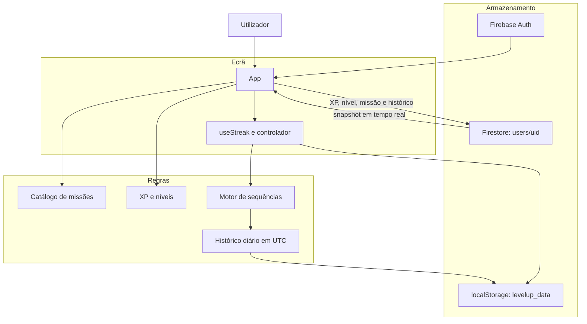

# Level Up ⚡

**Trade endless scrolling for short daily missions.** Level Up is a mobile-first web app that turns
a few minutes of distraction into quick challenges, with XP, levels and daily streaks.

> Screenshots / GIF: _add 2–3 images here (home, mission, reward/streak screen)._

## Features

- **Daily missions** with a timer and an XP reward
- **Levels and progression** with smooth animations (Motion)
- **Streaks:** consecutive days, personal record and a "perfect week" celebration
- **Frictionless sign-in:** start anonymously, then link a Google or Apple account (Firebase Auth)
- **Offline-friendly:** persistent Firestore cache
- **Firestore security rules** that validate field types and document ownership
- **1v1 challenge flow (prototype):** lobby, invite link/QR and match result screens

## Tech stack

| Layer | Technology |
|---|---|
| UI | React 19, TypeScript, Tailwind CSS 4, Motion |
| Data & auth | Firebase Auth, Cloud Firestore (with security rules), Analytics |
| Tooling | Vite, Vitest, GitHub Actions |

## Arquitetura

O ecrã, as regras de progressão e o armazenamento estão separados. O React mostra o estado e reage ao toque. O XP, os níveis, o catálogo de missões e as sequências diárias (streaks) são funções puras, sem browser, e é aí que os testes entram. A sessão e a sincronização passam pelo Firebase.



Quando uma missão termina, o fluxo é este:

1. O catálogo calcula a duração e o XP dessa missão.
2. O total de XP sobe. No ecrã, o nível é a divisão inteira do XP por 100. No documento do Firestore, um perfil com 0 XP fica gravado como nível 1.
3. O controlador acrescenta o dia UTC ao histórico, sem repetir o mesmo dia. O motor recalcula a sequência, o recorde e a semana perfeita.
4. O estado funde-se no `localStorage` e, cerca de um segundo depois, no documento `users/{uid}`.
5. Ao abrir a aplicação, o snapshot do Firestore repõe o índice da missão, o XP e o histórico. O motor reconcilia a sequência com o dia UTC de hoje, incluindo perfis antigos que ainda não tinham histórico diário.

## Streak engine

The streak logic lives in pure, framework-free functions, which makes it easy to test:

```
src/services/streak/
├── streakEngine.ts        # current streak, personal record, perfect-week detection
├── streakEngine.test.ts   # streak unit tests (Vitest)
├── streakHistory.test.ts  # dedupe, trim and legacy history recovery
├── streakHistory.ts       # per-day (UTC) completion history and de-duplication
├── streakStorage.ts       # local persistence
└── streakTypes.ts         # shared types
src/features/streak/       # glue between the engine and the UI
src/hooks/useStreak.ts     # React hook
```

## Getting started

Requirements: Node.js 20+ and a Firebase project (Auth + Firestore enabled).

```bash
git clone https://github.com/ottonielmorais2008-rgb/level-up.git
cd level-up
npm ci
cp .env.example .env.local   # fill in your Firebase web app config
npm run dev                  # http://localhost:3000
```

Deploy the security rules with the Firebase CLI: `firebase deploy --only firestore:rules`.

## Scripts

| Command | What it does |
|---|---|
| `npm run dev` | Start the dev server |
| `npm run lint` | Type-check with `tsc --noEmit` |
| `npm test` | Run the unit tests (Vitest) |
| `npm run build` | Production build |

## Como correr os testes

Os testes usam o Vitest e correm em Node. Não é preciso Firebase, variáveis de ambiente nem browser.

```bash
npm ci
npm test
```

`npm test` executa todos os ficheiros `*.test.ts`: progressão (XP, níveis e recompensas das missões), histórico das sequências e o motor de sequências. Para repetir um ficheiro enquanto se edita:

```bash
npx vitest src/services/progression/progression.test.ts
```

Na integração contínua, cada push e cada pull request corre `npm ci`, a verificação de tipos (`npm run lint`), `npm test` e `npm run build`.

## Known issues / roadmap

- **`src/App.tsx` is very large** (~3,400 lines). Next step: split it into screens and components.
- **XP and streaks are written by the client.** The Firestore rules check types, not how much XP was
  earned, so a user could inflate their own score. Plan: move XP awarding to a Cloud Function or
  limit increments in the rules.
- **Profiles are readable by any signed-in user** (including anonymous users), which is needed for
  challenges. Plan: split public and private profile fields.
- **Streak days are counted in UTC.** In Portugal, a mission completed between 00:00 and 01:00
  during summer time counts for the previous day.
- **Share/QR links point to `https://levelup.app`**, a domain this project does not control. They
  should use the app's real deployment URL (e.g. from an environment variable).
- **1v1 challenges are a UI prototype:** the invite link is generated in the browser and is not yet
  backed by real matchmaking.
- Some dependencies from the original prototype (`@google/genai`, `express`, `dotenv`) are not used by
  the current code and can be removed.

### Recently fixed

- The "perfect week" celebration never fired: the engine compared the streak before and after a
  completion using the same history. The completion is now compared against the history from
  *before* it was recorded (covered by `streakEngine.test.ts`).

## What went wrong

The "perfect week" celebration never fired. It is supposed to run when a new completion day brings
the streak to a multiple of 7. `completeMissionFromHistory` compared the streak before and after
using the same history, which already included today's completion. That day was already marked
complete, so it was not a new day, the streak did not count as increased, and
`shouldCelebratePerfectWeek` stayed false.

That shared-history comparison is still what the function does if the earlier history is omitted
(its comment calls this the old behaviour). `streakEngine.test.ts` covers both results: `does not
celebrate twice on the same day` passes one seven-day history for both sides and expects the flag
to stay off; `detects a new completion day and celebrates a perfect week` passes the six days from
before the seventh completion and expects the flag on, with streak 7. The fix passes that earlier
history. `handleMissionStreakUpdate` sends `session.history` from before the new day is recorded,
and `completeMissionToday` copies the history before appending today.

- **XP is written by the client.** Firestore rules require `xp` to be a non-negative integer on the
  owner's document. They accept any larger value, so a signed-in user can inflate their own score.
  Plan: move XP awarding to a Cloud Function, or limit increments in the rules.
- **Streak days are counted in UTC.** In Portugal, a mission completed between 00:00 and 01:00
  during summer time counts for the previous day.
- **Share and QR links point to `https://levelup.app`**, a domain this project does not control.
  They should use the app's real deployment URL (for example from an environment variable).
- **`src/App.tsx` is very large** (about 3,400 lines). Next step: split it into screens and
  components.
- **`@google/genai`, `express`, and `dotenv` are unused.** They come from the original prototype
  and can be removed.

## How it was built

The first prototype was generated with Google AI Studio (AI-assisted development). This version adds
environment-based Firebase configuration, the streak fix with unit tests, documented known issues
and CI. Project rules for AI coding assistants are in `.cursor/rules/`.

## License

[MIT](LICENSE). `src/App.tsx` keeps the Apache-2.0 header from the original Google AI Studio template.
